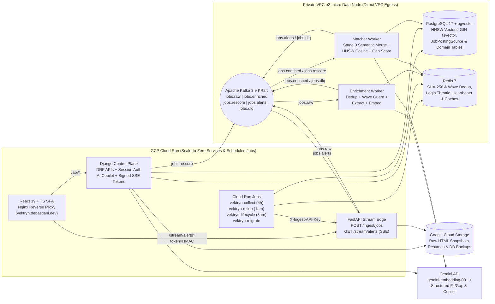

# Vektryn

[](https://github.com/debastiani-dev/vektryn/actions/workflows/ci.yml)
[](https://github.com/debastiani-dev/vektryn/actions/workflows/deploy-gcp.yml)
[](https://vektryn.debastiani.dev)

**Vektryn** is an event-driven job intelligence platform that continuously ingests software engineering roles across 14 global and Brazilian ATS/feed sources, merges cross-source near-duplicates and reposts into single canonical postings with Direct ATS link precedence, and tracks live tech-stack market trends. Up to 5 active multilingual resumes are semantically routed via `pgvector` before BYOK Gemini models generate structured gap analysis and on-demand application drafts—live on GCP at **[vektryn.debastiani.dev](https://vektryn.debastiani.dev)**.

> **Why "Vektryn"?** **Vekt-** (*vector / Vektor*) reflects the `pgvector` semantic similarity engine and directional tech-market vectors; **-ryn** (from Old English/Norse *rin* / *ryn*, a fast-flowing channel or current) reflects the continuous Apache Kafka pipeline filtering high-signal postings out of noisy ATS streams.

## Table of Contents

- [Core Capabilities](#core-capabilities)
- [System Architecture & Event Flow](#system-architecture--event-flow)
- [Tech Stack & Monorepo Structure](#tech-stack--monorepo-structure)
- [API & Security Overview](#api--security-overview)
- [Local Development & Testing](#local-development--testing)
- [Production & Operations](#production--operations)

---

## Core Capabilities

| Domain | Capabilities |
| --- | --- |
| **Multi-Source Ingestion & Manual Import** | 8 Direct ATS collectors (`Greenhouse`, `Ashby`, `Lever`, `Workable`, `SmartRecruiters`, `Recruitee`, `Breezy`, `InHire`) + 6 Global/BR feeds (`Remotive`, `Himalayas`, `Jobicy`, `Gupy`, `Trampos`, `GitHub Vagas`) with dynamic slug discovery and SSRF-guarded manual URL/text import. |
| **Cross-Source Near-Duplicate & Repost Merging** | Two-layer deduplication (pre-enrichment collector + tier-aware wave guard and `pgvector` semantic merging) collapses syndicated listings into one canonical posting with `JobPostingSource` provenance, Direct ATS `apply_url` precedence over aggregators, repost tracking (`+N sources`, `Reposted`, `Hide Reposts`), source-aware lifecycle failover, and zero wasted enrichment or BYOK quota. |
| **Multi-Resume, Work Mode & Multilingual Routing** | Supports up to 5 concurrent active resumes across any ISO 639-1 language with automated work-mode (`remote` / `hybrid` / `onsite`) and language classification, selecting strictly one winning resume per role before AI scoring. |
| **Two-Stage Semantic Scoring & Rescoring** | `pgvector` HNSW cosine similarity and targeting gates filter roles before BYOK Gemini evaluates fit (`0–100`), matched skills, missing keywords, and talking points in the posting's language—with automatic/on-demand retroactive rescoring and stale-score detection. |
| **Hybrid Search, Triage & Saved Presets** | Reciprocal Rank Fusion merges PostgreSQL full-text search with `pgvector` semantic recall alongside work-mode, language, source, and `Hide Reposts` filters, role dismissal, company muting, and named `SavedFilter` presets. |
| **On-Demand AI Application Copilot** | Generates cached, language-aligned Markdown drafts (tailored bullets, cover letter, recruiter outreach, interview prep, questions to ask) grounded in user profile identity and match analysis with tone controls and rate limiting. |
| **Kanban Tracker, Reminders & Export** | 8-stage Kanban pipeline auto-linked to the winning resume with inline resume switching, overdue follow-up reminders, automated closed-job alerts, and formula-safe CSV/JSON export. |
| **Notifications, Analytics & Pipeline Telemetry** | Persistent notification inbox merged live with signed HMAC SSE alerts, daily `StackTrendDaily` market benchmarks + personal funnel/skill-gap analytics, and in-app `PipelineStatusPopover` / `DlqInspectorModal` worker and DLQ ops. |
| **Auth Hardening, Profiles & Staff Admin** | Session auth with Redis brute-force login throttling, self-service profile/password/deactivation controls, and staff-only user CRUD with eager session invalidation and concurrency-safe last-admin guards. |

---

## System Architecture & Event Flow



### End-to-End Pipeline Flow

1. **Ingest & Layer 1 Pre-Dedup:** Scheduled collectors (`vektryn-collect`) and SSRF-guarded manual imports run priority-ordered batch and PostgreSQL pre-dedup before snapshotting raw HTML to GCS and publishing validated events to `jobs.raw`.
2. **Wave-Guard & Enrich:** `enrichment-worker` enforces SHA-256 content locks and a tier-aware 6h Redis wave guard (suppressing equal/lower-tier syndication while letting Direct ATS upgrades pass), then extracts structured metadata and 768-dim `gemini-embedding-001` vectors into `jobs.enriched`.
3. **Semantic Merge, Route & Score:** `matcher-worker` runs Stage 0 `pgvector` near-duplicate merging to link `JobPostingSource` provenance, promote Direct ATS links, and track reposts, then routes each role to at most one winning resume for BYOK Gemini gap evaluation and live alerts on `jobs.alerts`.
4. **Serve, Stream & Lifecycle Failover:** Django serves Hybrid RRF search, Job Radar (`+N sources` / `Reposted` badges, Observed Sources drawers), AI Copilot drafts, Kanban tracking, and analytics, while FastAPI streams SSE alerts and `vektryn-lifecycle` probes observed sources for source-aware close or failover.

---

## Tech Stack & Monorepo Structure

| Layer | Technologies |
| --- | --- |
| **Control Plane** | Python 3.13+, Django 6.1, Django REST Framework, `drf-spectacular`, Pydantic Settings, Gunicorn, WhiteNoise |
| **Async Edge & Workers** | FastAPI, Uvicorn, Pydantic v2, HTTPX, BeautifulSoup4, `confluent-kafka`, `psycopg` 3 |
| **Event Streaming** | Apache Kafka 3.9 (KRaft mode — `jobs.raw`, `jobs.enriched`, `jobs.rescore`, `jobs.alerts`, `jobs.dlq`) |
| **Data & Vector Store** | PostgreSQL 17 + `pgvector` (HNSW vector + GIN `tsvector`), Redis 7 |
| **AI & NLP** | Google Gemini API (`gemini-embedding-001` + tiered BYOK Gemini 3.5/3.8/4), `py3langid >= 0.4.0` |
| **Frontend** | React 19, TypeScript, Vite 8, Tailwind CSS v4, Lucide Icons, Nginx 1.27 |
| **Observability** | In-app `PipelineStatusPopover` & `DlqInspectorModal`, GCP Cloud Run Logs/Metrics, Sentry |
| **Cloud, IaC & CI/CD** | GCP (Cloud Run, Cloud Scheduler, Compute Engine `e2-micro`, GCS, Secret Manager, VPC/IAP, OIDC WIF), Terraform 1.11+, GitHub Actions |

### Top-Level Layout

```text
vektryn/
├── .github/                    # Path-filtered 4-job PR CI, incremental BuildKit CD & change classifiers
├── docs/
│   └── OPERATIONS.md           # GCP topology, CI/CD, Sentry observability, backfills & PG DR runbook
├── packages/
│   └── contracts/              # Shared Pydantic v2 events, enums, dedup.py, language.py & HMAC stream tokens
├── services/
│   ├── control-plane/          # Django 6 + DRF persistence owner, REST APIs, Copilot, auth & staff admin
│   └── stream-edge/            # FastAPI ingestion/SSE edge, 14 ATS/feed collectors & Kafka/batch workers
├── frontend/                   # React 19 + TypeScript + Vite 8 + Tailwind v4 SPA & Nginx reverse proxy
├── infra/                      # Postgres extension bootstrap (docker/) & modular GCP Terraform (terraform/)
├── docker-compose.yml          # Full local parity stack (Postgres, Redis, KRaft Kafka, services, workers, SPA)
├── Makefile                    # Unified stack, migration, worker, formatting, linting & test commands
└── README.md
```

<details>
<summary>Control Plane, Stream Edge & Frontend Module Breakdown</summary>

```text
services/control-plane/
├── config/                     # Pydantic settings, Sentry telemetry, URL routing, ASGI/WSGI entrypoints
└── apps/
    ├── base/                   # BaseModel, UserProfile, Notification, auth/users APIs, backfill_languages, backfill_job_sources & verify_sentry CLIs
    ├── resumes/                # Multi-active ResumeProfile CRUD (cap=5), language/work-mode routing, embeddings & jobs.rescore
    ├── jobs/                   # JobPosting + JobPostingSource provenance, Hybrid RRF search, SavedFilter, triage & manual import
    ├── matching/               # Single-winner MatchScore feed, cross-source/repost filters & MatchArtifact AI Copilot
    ├── tracker/                # ApplicationLead Kanban CRUD, follow-up reminders & CSV/JSON export
    └── analytics/              # StackTrendDaily, PersonalAnalytics, CollectorRunLog & /api/v1/system/{status,collect,dlq}/*
```

```text
services/stream-edge/src/stream_edge/
├── main.py / config.py / telemetry.py
├── api/                        # ingest.py (POST /ingest/jobs), alerts_sse.py (SSE), internal.py (local collect trigger)
├── clients/                    # kafka.py, redis.py (SHA-256 + 6h wave guard), heartbeat.py, notifications.py, gemini.py, gcs.py
├── collectors/                 # 8 ATS board collectors + 6 Global/BR feeds, discovery, taxonomy, prefilter & run.py
└── workers/                    # enrichment.py, matcher.py (Stage 0 dedup + scoring), rollup.py, lifecycle.py, dlq_replay.py
```

```text
frontend/src/
├── api/                        # Typed REST client & SSE helpers
├── components/
│   ├── landing/                # Zero-API static public landing page & coded interactive workspace previews
│   ├── layout/                 # AppShell, NotificationCenter, PipelineStatusPopover & DlqInspectorModal
│   ├── radar/                  # JobRadarView, RadarMetadataFilters, JobPostingDrawer, GapAnalysisDrawer & ObservedSourcesSection.tsx
│   ├── tracker/                # PipelineTrackerView Kanban board & lead detail drawer
│   ├── analytics/              # Market Stack Trends & Personal Funnel/Skill-Gap panels
│   └── resumes/                # Multi-resume manager & targeting configuration
└── utils/                      # Filter/preset serialization, formatting, work-mode/language helpers & XSS-safe Markdown
```

</details>

---

## API & Security Overview

| Prefix | Service | Purpose |
| --- | --- | --- |
| `/api/v1/auth/` | Control Plane | CSRF cookie, throttled login/logout, `/me/` (profile + HMAC `stream_token`), profile, password rotation & deactivation |
| `/api/v1/users/` | Control Plane | Staff-only (`IsAdminUser`) paginated user management & soft deactivation |
| `/api/v1/resumes/` | Control Plane | Multi-active resume CRUD, file upload, ISO 639-1 auto-detection, embeddings & `POST /{uuid}/rescore/` |
| `/api/v1/jobs/` | Control Plane | Job catalog, Hybrid RRF `?search=`, `?work_mode=`, `?language=`, cross-source `?ats_source=`, `?hide_reposts=`, `POST /import/`, `/filters/` & triage |
| `/api/v1/matches/` | Control Plane | Deduplicated Auto-Matched feed (`?resume_profile=`, `?work_mode=`, `?language=`, `?ats_source=`, `?hide_reposts=`) & `/{uuid}/artifacts/` Copilot |
| `/api/v1/leads/` | Control Plane | Kanban `ApplicationLead` CRUD, resume switching, follow-up reminders & `GET /export/?format=csv\|json` |
| `/api/v1/notifications/` | Control Plane | Persistent user inbox (`unread_count`, `?unread=`, `?kind=`), read/dismiss & read-all |
| `/api/v1/analytics/` | Control Plane | Macro stack trends (`/trends/`) & user-scoped funnel/channel/skill-gap analytics (`/personal/`) |
| `/api/v1/system/` | Control Plane | Operational pipeline status & worker heartbeats (`/status/`), staff collector trigger (`/collect/`), staff DLQ ops (`/dlq/*`) |
| `/stream/alerts` & `/ingest/jobs` | Stream Edge | Signed HMAC-SHA256 unbuffered SSE alert stream and API-key-authenticated job ingestion |
| `/health/`, `/api/v1/health/`, `/health`, `/api/docs/` | Both | Liveness probes and OpenAPI 3 / Swagger UI |

### Key Security Invariants

- **Proxy, TLS & CSRF Hardening:** Enforces proxy TLS headers, `HttpOnly`/`SameSite` session cookies, `CSRF_TRUSTED_ORIGINS`, and `X-CSRFToken` on all mutating endpoints.
- **Abuse & Brute-Force Controls:** Redis-backed per-IP and per-account login throttling (`429` + `Retry-After`), per-user Copilot rate limits, and Redis cooldown locks on collector/rescore/DLQ actions.
- **Strict Tenant Isolation:** Every resume, match, artifact, lead, saved filter, triage rule, notification, and personal analytics query is scoped strictly to `request.user`.
- **SSRF & Payload Defenses:** Manual URL import blocks private/loopback/metadata IPs across redirects; CSV exports neutralize spreadsheet formulas; SPA Markdown rendering is XSS-safe.
- **Private Network & Secret Hygiene:** Postgres, Redis, Kafka, and workers run in a private GCP VPC with IAP-only SSH, GCP Secret Manager runtime secrets, and PII-scrubbed Sentry telemetry.

---

## Local Development & Testing

### Prerequisites & Quickstart

Requires **Docker + Docker Compose**, **Python 3.13+ & Poetry 2.0+**, **Node.js 22+**, and a Google AI Studio `GEMINI_API_KEY` + Fernet `BYOK_ENCRYPTION_KEY`.

```bash
# 1. Clone and configure local environment
git clone https://github.com/debastiani-dev/vektryn.git
cd vektryn
cp .env.example .env

# 2. Install host dependencies for tests, linters, and CLIs
for dir in packages/contracts services/control-plane services/stream-edge; do
  poetry -C "$dir" install
done
npm --prefix frontend ci

# 3. Start full stack, run migrations, and create an admin user
make up
make migrate
make createsuperuser
```

Sign in at `http://localhost:3000/`, add your Gemini API key in **Account Settings → AI & API Key**, upload a resume, and run `make collect`.

### Local Service URLs

| Service | URL | Notes |
| --- | --- | --- |
| **Frontend SPA (Docker / Nginx)** | `http://localhost:3000/` | Production Vite build served via Nginx (`make up` / `make up/frontend`) |
| **Frontend SPA (Vite HMR)** | `http://localhost:5173/` | Instant HMR via `npm --prefix frontend run dev` |
| **Control Plane Swagger UI** | `http://localhost:8000/api/docs/` | Interactive OpenAPI docs (`/api/schema/` for raw schema) |
| **Django Admin** | `http://localhost:8000/admin/` | Staff administration console |
| **Stream Edge Health** | `http://localhost:8001/health` | FastAPI ingestion & SSE edge liveness check |

### Makefile Commands

| Category | Command | Description |
| --- | --- | --- |
| **Stack** | `make up` / `make up/backend` / `make up/frontend` / `make down` / `make logs` | Build/start/stop Docker Compose services or stream logs |
| **Django** | `make check` / `make migrate` / `make makemigrations` / `make shell` / `make runserver` / `make createsuperuser` | Checks, migrations (`app=<name>` optional), shell, dev server, or superuser |
| **Edge & Workers** | `make edge` / `make collect` / `make worker/enrichment` / `make worker/matcher` | Run FastAPI edge, all 14 ATS/feed collectors, or Kafka workers locally |
| **Batch & DLQ** | `make worker/rollup` / `make worker/lifecycle` / `make worker/dlq` | Daily trend rollup, source-aware lifecycle sweep, or DLQ peek/replay (`args="--execute"`) |
| **Quality** | `make test` / `make lint` / `make format` | Run all 4 test suites (`opts="-k ..."`), Python/frontend linters, or Ruff/Black auto-format |

### Testing & Code Standards

- **Suites:** `pytest` (`pytest-django` / `pytest-asyncio`) across `contracts`, `control-plane`, `stream-edge`, and `.github/scripts`; **Vitest** on `frontend`. All external HTTP, Kafka, GCS, and Gemini calls are mocked for deterministic offline runs.
- **Formatting & Linting:** **Ruff** + **Black** (`make lint/python`, imports at top of file); **Oxlint** (`--deny-warnings`) + strict **TypeScript** (`tsc -b`) (`make lint/frontend`).

<details>
<summary>Environment Variables Reference</summary>

| Variable | Scope | Purpose |
| --- | --- | --- |
| `GEMINI_API_KEY` | Enrichment Worker | Platform Google AI Studio key for job enrichment and `gemini-embedding-001` vectors |
| `BYOK_ENCRYPTION_KEY` | Control Plane & Matcher | Fernet symmetric key (`urlsafe_b64` of 32 bytes) encrypting per-user BYOK Gemini keys |
| `GEMINI_EMBEDDING_MODEL` / `GEMINI_ENRICHMENT_MODEL` / `GEMINI_ENRICHMENT_FALLBACK_MODEL` / `ENRICHMENT_DAILY_CAP` | Backend & Workers | Optional model chain and daily enrichment quota overrides |
| `DATABASE_URL` / `POSTGRES_*` | Backend & Workers | PostgreSQL connection (`DATABASE_URL` in Cloud Run; `POSTGRES_HOST=localhost` for host Make targets) |
| `REDIS_URL` | Backend & Workers | Redis instance for dedup/wave locks, login throttling, worker heartbeats, and caches |
| `NEAR_DUP_COSINE_THRESHOLD` / `NEAR_DUP_LOOKBACK_DAYS` / `REPOST_MIN_AGE_DAYS` / `MIN_DEDUP_DESC_CHARS` / `WAVE_DEDUP_TTL_SECONDS` | Stream Edge & Workers | Cross-source near-duplicate & repost merging thresholds (defaults: `0.94`, `90`d, `14`d, `150` chars, `21600`s) |
| `KAFKA_BOOTSTRAP_SERVERS` / `KAFKA_SECURITY_PROTOCOL` / `KAFKA_SASL_*` | Backend & Workers | Kafka broker address and optional SASL/TLS settings |
| `INGEST_API_KEY` / `STREAM_AUTH_SECRET` | Control Plane & Stream Edge | Shared `X-Ingest-API-Key` secret and HMAC-SHA256 SSE token signing secret |
| `STORAGE_BACKEND` / `GCS_SNAPSHOTS_BUCKET` / `GCS_RESUMES_BUCKET` / `GCS_DB_BACKUPS_BUCKET` | Backend, Workers & Backup | `local` in dev (`.local_storage/`) or `gcs` buckets in production |
| `GREENHOUSE_BOARD_TOKENS` / `ASHBY_BOARD_TOKENS` | Collectors | Optional comma-separated pinned ATS board slugs merged into discovery |
| `HYBRID_SEARCH_MIN_SIMILARITY` / `MAX_ACTIVE_RESUMES_PER_USER` | Control Plane | Semantic RRF threshold (default `0.60`) and active resume cap per user (default `5`) |
| `COPILOT_GEMINI_TIMEOUT_MS` / `COPILOT_RATE_LIMIT_*` | Control Plane | AI Copilot timeout (`50000` ms) and per-user Redis rate limits (`15` req / `300s`) |
| `AUTH_LOGIN_*` | Control Plane | Redis brute-force login throttle thresholds (`5` acct, `20` IP, `900s` window, `1` trusted proxy hop) |
| `SENTRY_DSN` / `SENTRY_ENVIRONMENT` / `SENTRY_TRACES_SAMPLE_RATE` / `SENTRY_RELEASE` / `SENTRY_SERVICE_NAME` / `VITE_SENTRY_*` | All Runtimes | Optional Sentry error tracking (`traces_sample_rate=0.0`; zero-op when DSN is blank) |

</details>

---

## Production & Operations

Full production runbooks and infrastructure details live in **[`docs/OPERATIONS.md`](docs/OPERATIONS.md)**:

- **GCP Topology:** Terraform-managed Cloud Run services/jobs, private VPC `e2-micro` data & worker node, GCS buckets, Secret Manager, and keyless OIDC WIF ([`docs/OPERATIONS.md#gcp-topology`](docs/OPERATIONS.md#gcp-topology)).
- **CI/CD Pipelines:** Path-filtered 4-job PR CI and incremental BuildKit CD with ordered `matcher-worker` → `enrichment-worker` IAP rollouts ([`docs/OPERATIONS.md#cicd-pipelines`](docs/OPERATIONS.md#cicd-pipelines)).
- **Observability & Maintenance:** In-app telemetry, Free-plan Sentry monitoring across all 9 runtimes, and Cloud Run `vektryn-migrate` commands for `backfill_languages` and `backfill_job_sources` ([`docs/OPERATIONS.md#consolidated-observability`](docs/OPERATIONS.md#consolidated-observability), [`docs/OPERATIONS.md#one-off-backfill--maintenance-commands`](docs/OPERATIONS.md#one-off-backfill--maintenance-commands)).
- **Backups & Disaster Recovery:** Automated daily `05:00 UTC` `pg_dump` archives to append-only GCS with 14-day retention and step-by-step `pg_restore` runbook ([`docs/OPERATIONS.md#postgresql-backup--disaster-recovery-restore-runbook`](docs/OPERATIONS.md#postgresql-backup--disaster-recovery-restore-runbook)).
