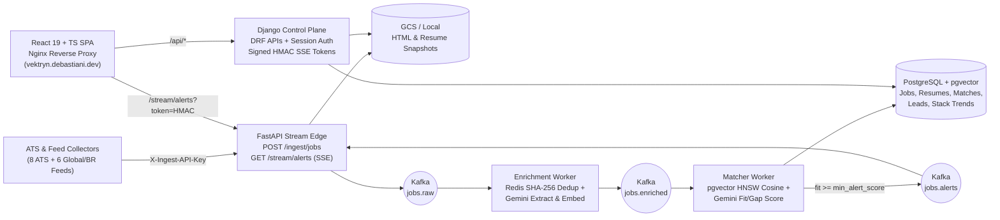

# Vektryn

[](https://github.com/debastiani-dev/vektryn/actions/workflows/ci.yml)
[](https://github.com/debastiani-dev/vektryn/actions/workflows/deploy-gcp.yml)
[](https://vektryn.debastiani.dev)

**Vektryn** is an event-driven fullstack job intelligence platform that continuously ingests remote software engineering postings across global and Brazilian ATS platforms, tracks live tech-stack demand, and semantically scores resumes against incoming roles with structured AI gap analysis.

Built with [Django](https://docs.djangoproject.com/) + [Django REST Framework](https://www.django-rest-framework.org/), [FastAPI](https://fastapi.tiangolo.com/), [Apache Kafka](https://kafka.apache.org/), [PostgreSQL + pgvector](https://github.com/pgvector/pgvector), [Gemini API](https://ai.google.dev/), and [React](https://react.dev/) + [TypeScript](https://www.typescriptlang.org/) + [Tailwind CSS](https://tailwindcss.com/).

## Table of Contents

- [Architecture](#architecture)
  - [Highlights](#highlights)
- [Prerequisites](#prerequisites)
- [Configuration](#configuration)
  - [Development Environment](#development-environment)
  - [Key Environment Variables](#key-environment-variables)
  - [Access and Documentation](#access-and-documentation)
- [Development](#development)
  - [Makefile Commands](#makefile-commands)
  - [Frontend Hot-Reload](#frontend-hot-reload)
- [Project Structure](#project-structure)
  - [Monorepo Layout](#monorepo-layout)
  - [Control Plane Apps](#control-plane-apps)
  - [Stream Edge Modules](#stream-edge-modules)
  - [Test Structure](#test-structure)
- [Tests](#tests)
  - [Execution](#execution)
  - [Best Practices](#best-practices)
- [Observability](#observability)
- [Deployment](#deployment)
  - [Environments](#environments)
  - [CI/CD Pipelines](#cicd-pipelines)
- [Code Standards](#code-standards)
  - [Formatting & Linting](#formatting--linting)

## Architecture



### Highlights

- **Contract-First Monorepo**: Shared `vektryn-contracts` Pydantic v2 event schemas, domain enums, partition-key helpers, and HMAC-SHA256 stream tokens keep Django, FastAPI, and Kafka workers strictly aligned.
- **Two-Stage Semantic Funnel**: Stage 1 `pgvector` HNSW cosine similarity filters candidate roles before Stage 2 structured Gemini fit/gap analysis burns LLM tokens, with `resume_content_hash` stale-score detection.
- **Idempotent Event Pipeline**: Redis SHA-256 content-hash locks deduplicate reposts, `MatchScore.alert_sent_at` prevents duplicate SSE alerts on replays, and failed payloads route to `jobs.dlq` with dry-run/execute replay tooling.
- **$0/mo GCP-Native Production Topology**: Terraform provisions Cloud Run Services, scheduled Cloud Run Jobs (`vektryn-migrate`, `vektryn-collect`, `vektryn-rollup`, `vektryn-lifecycle`), and an Always-Free `e2-micro` private VPC data node (`10.8.0.10`) running `pgvector`, Redis, KRaft Kafka, and stream workers—deployed via keyless GitHub Actions OIDC Workload Identity Federation.

## Prerequisites

- [Docker](https://docs.docker.com/engine/install/) and [Docker Compose](https://docs.docker.com/compose/install/) (sufficient to run the full local stack)
- [Python](https://www.python.org/downloads/) 3.13+ and [Poetry](https://python-poetry.org/docs/#installation) 2.0+ (for host tests, linters, and CLIs)
- [Node.js](https://nodejs.org/) 22+ and npm (for frontend Vitest/linting or Vite HMR)
- [Terraform](https://developer.hashicorp.com/terraform/install) 1.11+ (for GCP infrastructure)
- A [Google AI Studio](https://aistudio.google.com/) `GEMINI_API_KEY`

## Configuration

### Development Environment

1. Clone the repository and create your local `.env` (set `GEMINI_API_KEY`):

```bash
git clone https://github.com/debastiani-dev/vektryn.git
cd vektryn
cp .env.example .env
```

2. Install host dependencies (for running `make test`, `make lint`, and local CLIs):

```bash
for dir in packages/contracts services/control-plane services/stream-edge; do
  poetry -C "$dir" install
done
npm --prefix frontend ci
```

3. Start the stack (including Postgres + `pgvector`, Redis, KRaft Kafka, stream workers, and observability), run migrations, and create your account:

```bash
make up
make migrate
make createsuperuser
```

4. Sign in at `http://localhost:3000/`, add a resume profile in the **Resumes** tab, and run `make collect` to ingest and score jobs.

### Key Environment Variables

| Variable | Purpose |
| --- | --- |
| `GEMINI_API_KEY` | Google AI Studio key for `gemini-embedding-001` vectors and structured fit/gap scoring |
| `DATABASE_URL` / `POSTGRES_*` | PostgreSQL connection (`DATABASE_URL` with optional `?sslmode=` in Cloud Run; `POSTGRES_HOST=localhost` for host Make targets) |
| `REDIS_URL` | Redis instance for SHA-256 job deduplication and ATS discovery caching |
| `KAFKA_BOOTSTRAP_SERVERS` | Kafka broker address (`kafka:9092` inside Docker, `localhost:29092` on host, `10.8.0.10:9092` in GCP VPC) |
| `INGEST_API_KEY` | Shared secret enforced via `X-Ingest-API-Key` on `POST /ingest/jobs` when set |
| `STREAM_AUTH_SECRET` | HMAC secret shared between Control Plane (`/api/v1/auth/me/`) and Stream Edge (`/stream/alerts`) |
| `STORAGE_BACKEND` / `GCS_*_BUCKET` | `local` in dev (`.local_storage/`) or `gcs` with `GCS_SNAPSHOTS_BUCKET` and `GCS_RESUMES_BUCKET` in production |
| `GREENHOUSE_BOARD_TOKENS` / `ASHBY_BOARD_TOKENS` | Optional comma-separated pinned ATS board tokens merged into dynamic discovery |
| `SENTRY_DSN` / `VITE_SENTRY_DSN` | Optional Sentry error tracking DSNs for Django, FastAPI/workers, and React (no-op when unset) |

### Access and Documentation

- **Live Production App**: https://vektryn.debastiani.dev
- **Local Frontend SPA**: http://localhost:3000/
- **Control Plane API Swagger**: http://localhost:8000/api/docs/
- **Control Plane OpenAPI Schema**: http://localhost:8000/api/schema/
- **Django Admin**: http://localhost:8000/admin/
- **Stream Edge Health**: http://localhost:8001/health
- **Prometheus**: http://localhost:9090/
- **Grafana (`Vektryn Pipeline Overview`)**: http://localhost:3001/ (`admin` / `vektryn_admin`)

## Development

### Makefile Commands

Run `make help` at any time for the full target list.

| Category | Command | Description |
| --- | --- | --- |
| **Stack** | `make up` / `make down` / `make logs` | Start, stop, or tail Docker Compose services |
| **Django** | `make check` / `make shell` / `make runserver` | System checks, management shell, or host dev server |
| **Migrations** | `make makemigrations` / `make migrate` / `make showmigrations` | Create, apply, or inspect migrations (`app=<name>` optional) |
| **Edge** | `make edge` | Run FastAPI stream-edge locally with `--reload` |
| **Collectors** | `make collect` | Run ATS + feed collectors and push matched jobs to stream-edge |
| **Workers** | `make worker/enrichment` / `make worker/matcher` | Run Kafka enrichment or pgvector matching worker locally |
| **Batch Jobs** | `make worker/rollup` / `make worker/lifecycle` | Run daily `StackTrendDaily` rollup or upstream closed-job check |
| **DLQ** | `make worker/dlq` | Inspect `jobs.dlq` (pass `args="--execute"` to replay) |

### Frontend Hot-Reload

`make up` serves the production Vite build via Nginx on port `3000`. For instant HMR during frontend development (proxies `/api` and `/stream` to ports `8000`/`8001`):

```bash
npm --prefix frontend run dev
```

## Project Structure

### Monorepo Layout

```text
vektryn/
├── .github/workflows/          # Unified PR/main CI (ci.yml) and keyless OIDC Cloud Run CD (deploy-gcp.yml)
├── packages/
│   └── contracts/              # Shared Pydantic v2 Kafka events, enums, HMAC stream tokens
├── services/
│   ├── control-plane/          # Django 6 + DRF persistence owner, REST APIs, session auth
│   └── stream-edge/            # FastAPI ingestion/SSE edge, collectors, Kafka workers
├── frontend/                   # React 19 + TypeScript + Vite 8 + Tailwind v4 SPA & Nginx
├── infra/
│   ├── docker/                 # Postgres init SQL, OTel Collector, Prometheus, Grafana dashboards
│   └── terraform/              # GCP Cloud Run, Jobs, Scheduler, e2-micro data node, GCS, IAM/WIF
├── docker-compose.yml          # Full local stack
├── Makefile                    # Unified dev, worker, test, and lint commands
├── pyproject.toml              # Shared workspace Ruff/Black tool config
└── README.md                   # Architecture diagram, local quickstart & deployment guide
```

### Control Plane Apps

```text
services/control-plane/
├── config/     # Pydantic settings (proxy/TLS/CSRF hardening), OTel/Sentry telemetry, ASGI/WSGI, URLs
└── apps/
    ├── base/       # Abstract BaseModel (UUID/timestamps/soft-delete) and session auth endpoints
    ├── resumes/    # ResumeProfile uploads (PDF/DOCX/TXT/MD), snapshot storage, 768-dim embeddings
    ├── jobs/       # JobPosting catalog, HNSW vector & GIN indexes, search/filter APIs
    ├── matching/   # MatchScore vector + Gemini gap analysis results and stale detection
    ├── tracker/    # ApplicationLead Kanban pipeline CRUD and ownership scoping
    └── analytics/  # StackTrendDaily market demand and median annual USD compensation rollups

Each domain app follows: models/, views/, serializers/, services/, filters/, admin/, urls.py
```

### Stream Edge Modules

```text
services/stream-edge/src/stream_edge/
├── api/          # FastAPI routers (POST /ingest/jobs, GET /stream/alerts SSE)
├── clients/      # Kafka producer/consumer, Redis dedup, Gemini API, GCS/local storage
├── collectors/   # 8 ATS board collectors + 6 Global/BR feeds, discovery, taxonomy, prefilter
├── workers/      # Kafka enrichment, pgvector matcher, daily rollup, lifecycle check, DLQ replay
├── config.py     # Pydantic BaseSettings (Kafka/SASL portability, Redis, GCS, Gemini keys)
├── metrics.py    # Custom Prometheus counters, gauges, histograms, and worker /metrics servers
└── telemetry.py  # OpenTelemetry OTLP tracer & optional Sentry SDK setup
```

### Test Structure

The monorepo maintains **37 deterministic unit and integration tests** across all four packages:

```text
packages/contracts/tests/test_events.py                  # Schemas, partition keys, HMAC tokens
services/control-plane/tests/test_api_and_serializers.py # Auth, IDOR scoping, proxy/TLS settings, Sentry, filters
services/stream-edge/tests/test_workers_and_config.py    # Ingest auth, SSE auth, DLQ, lifecycle, metrics, Sentry
frontend/src/api/client.test.ts                          # Pagination, CSRF, FormData upload, 204
frontend/src/utils/format.test.ts                        # Salary ranges, medians, labels, score themes
```

## Tests

The backend uses [pytest](https://docs.pytest.org/) (`pytest-django` + `pytest-asyncio`), and the frontend uses [Vitest](https://vitest.dev/).

### Execution

Ensure Docker infrastructure (`postgres`) is running before executing tests:

```bash
# Run complete suite (contracts, control-plane, stream-edge, frontend)
make test

# Filter Python tests with pytest options
make test opts="-k test_auth"
```

### Best Practices

- Implement and run all Django tests with `pytest` (`pytest-django`).
- Mock external HTTP/LLM calls (`unittest.mock`, `httpx.MockTransport`) so tests stay deterministic without live API keys.
- Cover security invariants (IDOR scoping, CSRF/session auth, `X-Ingest-API-Key`, signed SSE tokens) alongside domain logic.

## Observability

`make up` brings up the local telemetry stack automatically:

- **OpenTelemetry Collector** (`:4317` gRPC / `:4318` HTTP / `:8889` Prometheus exporter): Collects traces across Django Control Plane, FastAPI Stream Edge, and Kafka workers.
- **Prometheus** (`:9090`): Scrapes `/metrics` from `control-plane:8000`, `stream-edge:8001`, `enrichment-worker:9101`, `matcher-worker:9102`, and `otel-collector:8889`.
- **Grafana** (`:3001`): Auto-provisions the Prometheus datasource and **Vektryn Pipeline Overview** dashboard (targets up, SSE clients, ingest rate by ATS, worker throughput/DLQ, Gemini p95 latency/errors, processing duration).

## Deployment

### Environments

- **Local Development**: Docker Compose (`make up`) with KRaft Kafka, `pgvector/pgvector:pg17`, Redis, and `.local_storage/`.
- **GCP Production (`https://vektryn.debastiani.dev`)**: Terraform (`infra/terraform/`) managing:
  - **Cloud Run Services**: `vektryn-frontend` (Nginx reverse proxy with `$proxy_host` and unbuffered SSE + Google-managed TLS), `vektryn-control-plane`, and `vektryn-stream-edge` (`us-central1`).
  - **Cloud Run Jobs & Cloud Scheduler**: `vektryn-migrate` (`python manage.py migrate --noinput`), `vektryn-collect` (`0 */4 * * *` UTC), `vektryn-rollup` (`0 1 * * *` UTC), and `vektryn-lifecycle` (`0 3 * * *` UTC) connected over Direct VPC Egress (`10.8.0.0/24`).
  - **Private Data & Worker Node (`vektryn-data-node`)**: Always-Free `e2-micro` VM (`us-central1-a`, static internal IP `10.8.0.10`, 30 GB `pd-standard` + 2 GB swap) running `pgvector/pgvector:pg17`, `redis:7-alpine`, `apache/kafka:3.9.0` (KRaft), `enrichment-worker`, and `matcher-worker`, fetching secrets at boot via VM metadata token with IAP-only SSH (`35.235.240.0/20`).
  - **Storage, Secrets & Registry**: GCS buckets (`raw-snapshots`, `resumes`, `tfstate`), Artifact Registry (`vektryn`), and Secret Manager.

### CI/CD Pipelines

- **CI** ([.github/workflows/ci.yml](.github/workflows/ci.yml)): Runs on every pull request and push to `main` across 4 parallel jobs (`Contracts (Lint & Test)`, `Frontend (Lint, Typecheck & Build)`, `Control Plane (Lint & Test)`, `Stream Edge (Lint & Test)`), all enforced via strict `main` branch protection rules.
- **CD** ([.github/workflows/deploy-gcp.yml](.github/workflows/deploy-gcp.yml)): Runs on `push` to `main` (or `workflow_dispatch`); authenticates via keyless GCP Workload Identity Federation, pushes Docker images tagged with git SHA and `latest` to Artifact Registry, applies Terraform against GCS remote state, executes `vektryn-migrate`, and runs a `/api/v1/health/` smoke check.

## Code Standards

- [Ruff](https://docs.astral.sh/ruff/) & [Black](https://black.readthedocs.io/): Python linting and deterministic formatting
- [Oxlint](https://oxc.rs/docs/guide/usage/linter) (`--deny-warnings`) & [TypeScript](https://www.typescriptlang.org/) (`tsc -b`): Frontend linting and strict project-reference type checking

### Formatting & Linting

```bash
# Auto-fix Python lint issues and format with Black
make format

# Run full lint + typecheck suite (also enforced on every PR in CI)
make lint

# Run individually
make lint/python
make lint/frontend
```
