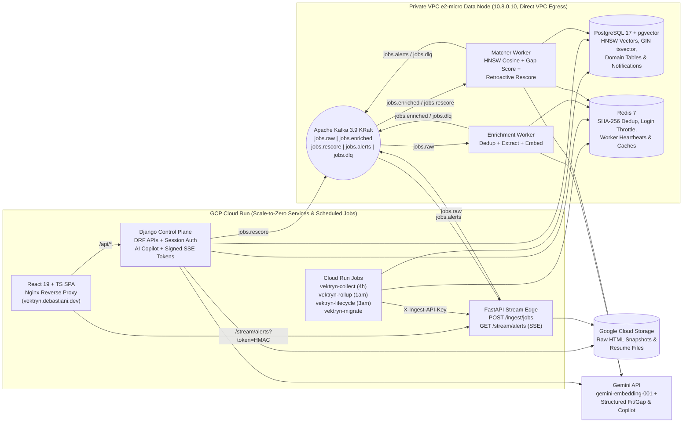

# Vektryn

[](https://github.com/debastiani-dev/vektryn/actions/workflows/ci.yml)
[](https://github.com/debastiani-dev/vektryn/actions/workflows/deploy-gcp.yml)
[](https://vektryn.debastiani.dev)

**Vektryn** is an event-driven fullstack job intelligence platform that continuously ingests remote software engineering postings across 14 global and Brazilian ATS/feed sources, tracks live tech-stack demand, and semantically scores resumes against incoming roles with structured AI gap analysis and on-demand application drafting—deployed on Google Cloud Platform at **[vektryn.debastiani.dev](https://vektryn.debastiani.dev)**.

> **Why "Vektryn"?** **Vekt-** (*vector / Vektor*) reflects the `pgvector` semantic similarity engine and directional tech-market vectors; **-ryn** (from Old English/Norse *rin* / *ryn*, a fast-flowing channel or current) reflects the continuous Apache Kafka pipeline filtering high-signal postings out of noisy ATS streams.

## Table of Contents

- [Core Capabilities](#core-capabilities)
- [System Architecture & Event Flow](#system-architecture--event-flow)
- [Tech Stack & Monorepo Structure](#tech-stack--monorepo-structure)
- [API & Security Overview](#api--security-overview)
- [Local Development & Configuration](#local-development--configuration)
- [Testing & Code Standards](#testing--code-standards)
- [Production Infrastructure, CI/CD & Observability](#production-infrastructure-cicd--observability)

---

## Core Capabilities

| Domain | Capabilities |
| --- | --- |
| **Multi-Source Ingestion & Manual Import** | 8 ATS board collectors (`Greenhouse`, `Ashby`, `Lever`, `Workable`, `SmartRecruiters`, `Recruitee`, `Breezy`, `InHire`) + 6 Global/BR feeds (`Remotive`, `Himalayas`, `Jobicy`, `Gupy`, `Trampos`, `GitHub Vagas`) with dynamic slug discovery, Devicon taxonomy sync, Redis SHA-256 deduplication, and SSRF-guarded manual job import (`POST /api/v1/jobs/import/` supporting public URL extraction or pasted descriptions with HTTP/HTTPS and `mailto:` apply targets). |
| **Two-Stage Semantic Scoring & Rescoring** | Stage 1 `pgvector` HNSW cosine similarity filters candidate roles before Stage 2 structured Gemini fit/gap evaluation (`0–100 fit_score`, `matched_skills`, `missing_keywords`, `talking_points`, `gap_summary`), with `resume_content_hash` stale detection (`is_stale`) and automatic/on-demand retroactive rescoring via `jobs.rescore`. |
| **Hybrid Keyword + Semantic Search** | Combines trigger-maintained PostgreSQL `tsvector` full-text search (GIN-indexed across `title`, `company_name`, `tech_stack`, `description_clean`) with `pgvector` HNSW cosine similarity via Reciprocal Rank Fusion (`RRF`, `k=60`), Redis-cached `gemini-embedding-001` query embeddings, graceful keyword-only fallback, and composable structured filters. |
| **Radar Triage & Saved Filter Presets** | Per-user role dismissal (`DismissedJob`), normalized company muting (`MutedCompany`) with quick undo, `Unapplied Only` (`untracked_only`) filtering applied ahead of Hybrid RRF search and KPIs, and one-click named `SavedFilter` presets (`/api/v1/jobs/filters/`). |
| **On-Demand AI Application Copilot** | Generates ready-to-use Markdown application drafts (`tailored_bullets`, `cover_letter`, `recruiter_outreach`, `interview_questions`) strictly on demand via Gemini, grounded in saved `UserProfile` identity/links, cached in PostgreSQL (`MatchArtifact`) per `(match_score, kind, resume_content_hash)`, with tone/guidance controls and per-user Redis rate limiting. |
| **Kanban Tracker, Reminders & Export** | 8-stage Kanban pipeline (`discovered` → `saved` → `applied` → `screening` → `interviewing` → `offer` / `rejected` / `withdrawn`), scheduled `next_action_at` follow-up reminders (overdue highlights + automated `vektryn-lifecycle` alerts), and formula-safe CSV/JSON export (`/api/v1/leads/export/`). |
| **Persistent Notification Center & SSE** | User-scoped PostgreSQL `Notification` inbox (`match_alert`, `tracked_job_closed`, `lead_followup_due`, `pipeline_error`, `rescore_completed`, `manual_import_ready`, `collector_sync_completed`) hydrated via REST and merged live with signed HMAC-SHA256 Server-Sent Events (`/stream/alerts` deduplicated by `notification_uuid`), plus daily 30-day retention pruning. |
| **Market & Personal Analytics** | Daily `StackTrendDaily` demand & normalized `median_annual_usd` benchmarks alongside PostgreSQL-aggregated user-scoped personal funnel conversion rates, channel performance (`ats_source` / `contract_type`), and recurring `missing_keywords` skill-gap charts with click-to-search jumps into `JobRadarView`. |
| **In-App Pipeline Telemetry & DLQ Ops** | `PipelineStatusPopover` displays per-source `CollectorRunLog` metrics, backlog/rollup freshness, Redis-backed worker liveness heartbeats (`enrichment-worker`, `matcher-worker`), a staff manual collector trigger, and `DlqInspectorModal` for staff inspection, dry-run preview, topic-allowlisted replay, and dismissal of `jobs.dlq` messages. |
| **Auth Hardening & Account Security** | Session authentication protected by proxy-aware Redis brute-force login throttling (`429 Too Many Requests` + `Retry-After`, fail-open resilience), self-service password rotation (`AUTH_PASSWORD_VALIDATORS` + `update_session_auth_hash`), and automatic SPA session-expiry handling. |
| **User Profile & Staff Administration** | Self-service `UserProfile` (`display_name`, validated IANA `timezone`, `preferred_currency`, `default_copilot_tone`, `http`/`https` social links) and password-confirmed soft deactivation, plus staff-only `/api/v1/users/` CRUD with eager session invalidation, read-only `is_superuser`, and concurrency-safe last-staff/superuser guards. |

---

## System Architecture & Event Flow



### End-to-End Pipeline Flow

1. **Ingest & Snapshot:** Scheduled collectors (`vektryn-collect`) and SSRF-guarded manual imports (`POST /api/v1/jobs/import/`) store raw HTML snapshots in GCS and push normalized payloads to FastAPI (`POST /ingest/jobs`), which validates schemas against `vektryn-contracts` and publishes to `jobs.raw`.
2. **Deduplicate & Enrich:** `enrichment-worker` claims SHA-256 content hashes in Redis, extracts structured metadata (`seniority`, `contract_type`, salary, `region_eligibility`, `tech_stack`) and 768-dim `gemini-embedding-001` embeddings via Gemini, and publishes to `jobs.enriched` (routing failures to `jobs.dlq`).
3. **Score, Rescore & Persist:** `matcher-worker` runs `pgvector` HNSW cosine filtering against active `ResumeProfile` rows, executes Stage 2 Gemini gap analysis, upserts `JobPosting` / `MatchScore` and persistent `Notification` rows atomically in PostgreSQL, and publishes `JobMatchAlertEvent` to `jobs.alerts`. Resume mutations or manual rescore requests publish to `jobs.rescore` for retroactive evaluation.
4. **Serve, Stream & Observe:** The React SPA queries Django DRF APIs (Hybrid RRF search, triage/presets, Copilot drafts, Kanban tracker, market/personal analytics, pipeline telemetry) and subscribes to unbuffered `GET /stream/alerts` SSE frames merged into `NotificationCenter`.

---

## Tech Stack & Monorepo Structure

| Layer | Technologies |
| --- | --- |
| **Control Plane** | Python 3.13+, Django 6.1, Django REST Framework, `drf-spectacular`, Pydantic Settings, Gunicorn, WhiteNoise |
| **Async Edge & Workers** | FastAPI, Uvicorn, Pydantic v2, HTTPX, BeautifulSoup4, `confluent-kafka`, `psycopg` 3 |
| **Event Streaming** | Apache Kafka 3.9 (KRaft mode — `jobs.raw`, `jobs.enriched`, `jobs.rescore`, `jobs.alerts`, `jobs.dlq`) |
| **Data & Vector Store** | PostgreSQL 17 + `pgvector` (HNSW vector + GIN `tsvector`), Redis 7 |
| **AI Pipeline** | Google Gemini API (`gemini-embedding-001` + Gemini Flash/Pro structured JSON & Markdown generation) |
| **Frontend** | React 19, TypeScript, Vite 8, Tailwind CSS v4, Lucide Icons, Nginx 1.27 |
| **Observability** | In-app `PipelineStatusPopover` & `DlqInspectorModal`, GCP Cloud Run Logs/Metrics, Sentry (`sentry-sdk` 3 + `@sentry/react` 11) |
| **Cloud, IaC & CI/CD** | GCP (Cloud Run Services/Jobs, Cloud Scheduler, Compute Engine `e2-micro`, GCS, Artifact Registry, Secret Manager, Direct VPC Egress, IAP OS Login, OIDC WIF), Terraform 1.11+, Docker BuildKit, GitHub Actions |

### Top-Level Layout

```text
vektryn/
├── .github/
│   ├── scripts/                # Incremental CD change classifier (detect_deploy_changes.py) + pytest suite
│   └── workflows/              # 4-job parallel PR CI (ci.yml) & incremental OIDC Cloud Run CD (deploy-gcp.yml)
├── packages/
│   └── contracts/              # Shared Pydantic v2 Kafka events, enums, topic helpers & HMAC stream tokens
├── services/
│   ├── control-plane/          # Django 6 + DRF persistence owner, REST APIs, Copilot, auth & staff admin
│   └── stream-edge/            # FastAPI ingestion/SSE edge, 14 ATS/feed collectors & Kafka/batch workers
├── frontend/                   # React 19 + TypeScript + Vite 8 + Tailwind v4 SPA & Nginx reverse proxy
├── infra/
│   ├── docker/                 # Postgres extension bootstrap (postgres/init.sql)
│   └── terraform/              # Modular GCP IaC (networking, storage, secrets, iam, data_node, cloud_run)
├── docker-compose.yml          # Full local parity stack (Postgres, Redis, KRaft Kafka, services, workers, SPA)
├── Makefile                    # Unified stack, migration, worker, formatting, linting & test commands
├── pyproject.toml              # Shared workspace Ruff/Black tool config
└── README.md
```

<details>
<summary>Control Plane & Stream Edge Module Breakdown</summary>

```text
services/control-plane/
├── config/
│   ├── settings.py             # Pydantic settings (proxy/TLS/CSRF hardening, Copilot/auth/search tuning)
│   ├── telemetry.py            # sentry-sdk 3.0 config, PII scrubbing & 4xx/health filtering
│   ├── urls.py                 # REST/health/Swagger/admin routing
│   └── asgi.py / wsgi.py       # Server entrypoints initializing Sentry
└── apps/
    ├── base/                   # BaseModel, UserProfile, Notification, /api/v1/auth/*, /api/v1/users/, verify_sentry CLI
    ├── resumes/                # ResumeProfile uploads (PDF/DOCX/TXT/MD), GCS storage, embeddings & jobs.rescore publishing
    ├── jobs/                   # JobPosting catalog, Hybrid RRF search, SavedFilter presets, DismissedJob/MutedCompany triage, SSRF-guarded manual import
    ├── matching/               # MatchScore gap views, stale detection & PostgreSQL-cached MatchArtifact AI Copilot
    ├── tracker/                # ApplicationLead Kanban CRUD, follow-up reminders & CSV/JSON export
    └── analytics/              # StackTrendDaily market trends, PersonalAnalytics funnel/skill-gaps, CollectorRunLog, /api/v1/system/{status,collect,dlq}/*
```

```text
services/stream-edge/src/stream_edge/
├── main.py                     # FastAPI app, CORS, Kafka/GCS lifespan, /health
├── config.py                   # Pydantic BaseSettings (Postgres, Redis, Kafka/SASL, GCS, Gemini, ATS boards)
├── telemetry.py                # sentry-sdk 3.0 config, PII scrubbing, worker/job capture & flush, --verify CLI
├── api/
│   ├── ingest.py               # POST /ingest/jobs (X-Ingest-API-Key -> GCS snapshot -> jobs.raw)
│   ├── alerts_sse.py           # GET /stream/alerts (HMAC token -> unbuffered SSE with notification_uuid dedup)
│   └── internal.py             # POST /internal/collect (API-key-protected local single-flight collector trigger)
├── clients/
│   ├── kafka.py                # Producer/consumer helpers, topic bootstrap & jobs.dlq envelope publishing
│   ├── redis.py                # SHA-256 content-hash deduplication client
│   ├── heartbeat.py            # Background 30s Redis worker liveness heartbeats (90s TTL, fail-open)
│   ├── notifications.py        # Direct Postgres Notification persistence & 30-day retention pruning
│   ├── gemini.py               # Structured metadata extraction, 768-dim embeddings & gap scoring
│   └── gcs.py                  # GCS / local snapshot storage abstraction
├── collectors/                 # 8 ATS board collectors + 6 Global/BR feeds, discovery, taxonomy, prefilter, run.py
└── workers/                    # enrichment.py, matcher.py, rollup.py, lifecycle.py, dlq_replay.py
```

</details>

---

## API & Security Overview

### Primary Endpoint Groups

| Prefix | Service | Purpose |
| --- | --- | --- |
| `/api/v1/auth/` | Control Plane | CSRF cookie, Redis-throttled login/logout, `/me/` (with `profile` & HMAC `stream_token`), `GET`/`PATCH /profile/`, `POST /change-password/`, `POST /deactivate/` |
| `/api/v1/users/` | Control Plane | Staff-only (`IsAdminUser`) paginated user management (`GET`, `POST`, `PATCH`, soft-deactivate `DELETE`) |
| `/api/v1/resumes/` | Control Plane | Resume profile CRUD (file upload or raw text), 768-dim embedding generation & `POST /{uuid}/rescore/` |
| `/api/v1/jobs/` | Control Plane | Job catalog with Hybrid RRF search (`?search=`), `POST /import/`, `/filters/` presets, `/dismissed/` & `/muted-companies/` triage |
| `/api/v1/matches/` | Control Plane | Resume-to-job `MatchScore` feed with Hybrid RRF search, stale flags & `GET`/`POST /{uuid}/artifacts/` AI Copilot |
| `/api/v1/leads/` | Control Plane | Kanban `ApplicationLead` CRUD, `next_action_at` reminders & `GET /export/?format=csv\|json` |
| `/api/v1/notifications/` | Control Plane | Persistent user inbox list (`unread_count`, `?unread=`, `?kind=`), `read/`, `dismiss/`, `read-all/` |
| `/api/v1/analytics/` | Control Plane | Macro market trends (`/trends/`) & user-scoped funnel/channel/skill-gap analytics (`/personal/`) |
| `/api/v1/system/` | Control Plane | Pipeline health & worker heartbeats (`/status/`), staff collector trigger (`/collect/`), staff DLQ peek/replay/dismiss (`/dlq/`, `/dlq/replay/`, `/dlq/dismiss/`) |
| `/stream/alerts` & `/ingest/jobs` | Stream Edge | Signed HMAC-SHA256 unbuffered SSE alert stream (`GET /stream/alerts?token=`) and API-key-authenticated ingestion (`POST /ingest/jobs`) |
| `/health/`, `/api/v1/health/`, `/health`, `/api/docs/` | Both | Liveness probes and OpenAPI 3 / Swagger UI documentation |

### Key Security Invariants

- **Proxy, TLS & CSRF Hardening:** Enforces `SECURE_PROXY_SSL_HEADER`, `USE_X_FORWARDED_HOST`, `HttpOnly` / `SameSite` session cookies, `CSRF_TRUSTED_ORIGINS`, and `X-CSRFToken` enforcement on all mutating endpoints.
- **Brute-Force & Abuse Controls:** Redis-backed per-IP and per-`(username, IP)` login throttling (`429` + `Retry-After`), per-user AI Copilot rate limiting, and collector/rescore/DLQ Redis cooldown locks.
- **Strict Tenant Isolation (IDOR Protection):** Every resume, match, artifact, lead, saved filter, dismissed job, muted company, notification, and personal analytics query is scoped strictly to `request.user`.
- **SSRF & Payload Defenses:** Manual job URL import blocks private/link-local/loopback/metadata IP ranges across redirects (`169.254.169.254`, RFC1918, IPv6 equivalents); CSV lead exports neutralize spreadsheet formula injection (`=`, `+`, `-`, `@`); Markdown rendering in the SPA uses a zero-dependency XSS-safe renderer.
- **Staff & Account Safety:** Soft-deactivation only (zero cascading hard deletes), eager session invalidation, read-only `is_superuser` from the API, and `select_for_update()` concurrency-safe guards preventing self-lockout or removing the last active staff/superuser account.
- **Private Network & Secret Hygiene:** Postgres, Redis, Kafka, and workers run inside a private GCP VPC (`10.8.0.0/24`) with IAP-only SSH (`35.235.240.0/20`, zero public DB/broker/SSH ports); runtime secrets live exclusively in GCP Secret Manager; Sentry enforces zero PII/cookie/header/token/password/resume leakage.

---

## Local Development & Configuration

### Prerequisites

- [Docker](https://docs.docker.com/engine/install/) and [Docker Compose](https://docs.docker.com/compose/install/)
- [Python](https://www.python.org/downloads/) 3.13+ and [Poetry](https://python-poetry.org/docs/#installation) 2.0+ (for host tests, linters, and CLIs)
- [Node.js](https://nodejs.org/) 22+ and npm (for frontend Vitest, linting, or Vite HMR)
- [Terraform](https://developer.hashicorp.com/terraform/install) 1.11+ (for GCP infrastructure)
- A [Google AI Studio](https://aistudio.google.com/) `GEMINI_API_KEY`

### Quickstart

1. Clone the repository and create your local `.env` (set `GEMINI_API_KEY`):

```bash
git clone https://github.com/debastiani-dev/vektryn.git
cd vektryn
cp .env.example .env
```

2. Install host dependencies (for `make test`, `make lint`, and local CLIs):

```bash
for dir in packages/contracts services/control-plane services/stream-edge; do
  poetry -C "$dir" install
done
npm --prefix frontend ci
```

3. Start the full local stack (PostgreSQL 17 + `pgvector`, Redis 7, KRaft Kafka, Control Plane, Stream Edge, Kafka workers, and Nginx SPA), apply migrations, and create your admin account:

```bash
make up
make migrate
make createsuperuser
```

4. Sign in at `http://localhost:3000/`, upload a resume in **Resumes**, and run `make collect` to ingest and score jobs.

### Local Service URLs

| Service | URL | Notes |
| --- | --- | --- |
| **Frontend SPA (Docker / Nginx)** | `http://localhost:3000/` | Production Vite build served via Nginx (`make up` / `make up/frontend`) |
| **Frontend SPA (Vite HMR)** | `http://localhost:5173/` | Instant HMR via `npm --prefix frontend run dev` (proxies `/api` → `:8000` and `/stream` → `:8001`) |
| **Control Plane Swagger UI** | `http://localhost:8000/api/docs/` | Interactive OpenAPI docs (`/api/schema/` for raw schema) |
| **Django Admin** | `http://localhost:8000/admin/` | Staff administration console |
| **Stream Edge Health** | `http://localhost:8001/health` | FastAPI ingestion & SSE edge liveness check |

### Makefile Commands

Run `make help` at any time for the full target list.

| Category | Command | Description |
| --- | --- | --- |
| **Stack** | `make up` / `make up/backend` / `make up/frontend` | Start full Docker Compose stack, backend services only, or frontend container only |
| **Stack** | `make down` / `make logs` | Stop Compose services or stream container logs |
| **Django** | `make check` / `make shell` / `make runserver` | System checks, Django shell, or host dev server (`PORT=8000`) |
| **Migrations** | `make makemigrations` / `make migrate` / `make showmigrations` | Create, apply, or inspect migrations (`app=<name>` optional) |
| **Admin** | `make createsuperuser` | Create a Django superuser interactively |
| **Edge & Collectors** | `make edge` / `make collect` | Run FastAPI edge (`EDGE_PORT=8001`) or execute all 14 ATS/feed collectors |
| **Workers** | `make worker/enrichment` / `make worker/matcher` | Run Kafka enrichment or `pgvector` matching worker locally |
| **Batch Jobs & DLQ** | `make worker/rollup` / `make worker/lifecycle` / `make worker/dlq` | Daily trend rollup, upstream closed-job/reminder sweep, or DLQ peek/replay (`args="--execute"`) |
| **Quality** | `make test` / `make lint` / `make format` | Run all 4 test suites (`opts="-k ..."`), all Python/frontend linters, or auto-format Python |

<details>
<summary>Environment Variables Reference</summary>

| Variable | Scope | Purpose |
| --- | --- | --- |
| `GEMINI_API_KEY` | Enrichment Worker | Platform Google AI Studio key for automated job enrichment (`gemini-3.5-flash-lite` -> `gemini-3.8-flash`) and `gemini-embedding-001` vectors |
| `BYOK_ENCRYPTION_KEY` | Control Plane & Matcher | Fernet symmetric key (`urlsafe_b64` of 32 bytes) for encrypting/decrypting per-user BYOK Gemini API keys |
| `GEMINI_EMBEDDING_MODEL` / `GEMINI_SCORING_MODEL` / `GEMINI_FALLBACK_SCORING_MODEL` | Backend & Workers | Override default embedding and primary/fallback scoring Gemini models |
| `DATABASE_URL` / `POSTGRES_*` | Backend & Workers | PostgreSQL connection (`DATABASE_URL` with optional `?sslmode=` in Cloud Run; `POSTGRES_HOST=localhost` for host Make targets) |
| `REDIS_URL` | Backend & Workers | Redis instance for SHA-256 job dedup, login throttling, worker heartbeats, query embedding & Copilot rate-limit caches |
| `KAFKA_BOOTSTRAP_SERVERS` / `KAFKA_SECURITY_PROTOCOL` / `KAFKA_SASL_*` | Backend & Workers | Kafka broker address (`kafka:9092` in Docker, `localhost:29092` on host, `10.8.0.10:9092` in GCP VPC) and optional SASL/TLS settings |
| `INGEST_API_KEY` | Control Plane & Stream Edge | Shared secret enforced via `X-Ingest-API-Key` on `POST /ingest/jobs` and `POST /internal/collect` |
| `STREAM_AUTH_SECRET` | Control Plane & Stream Edge | HMAC-SHA256 signing secret shared between `/api/v1/auth/me/` and `GET /stream/alerts` |
| `STORAGE_BACKEND` / `GCS_SNAPSHOTS_BUCKET` / `GCS_RESUMES_BUCKET` | Backend & Workers | `local` in dev (`.local_storage/`) or `gcs` with GCS buckets in production |
| `GREENHOUSE_BOARD_TOKENS` / `ASHBY_BOARD_TOKENS` | Collectors | Optional comma-separated pinned ATS board slugs merged into dynamic discovery |
| `HYBRID_SEARCH_MIN_SIMILARITY` | Control Plane | Minimum cosine similarity threshold for semantic candidates in Hybrid RRF search (default `0.60`) |
| `COPILOT_GEMINI_MODEL` / `COPILOT_GEMINI_FALLBACK_MODEL` / `COPILOT_GEMINI_TIMEOUT_MS` / `COPILOT_RATE_LIMIT_*` | Control Plane | Optional AI Application Copilot model override, timeout (`25000` ms), and per-user Redis rate limits (`15` req / `300s`) |
| `AUTH_LOGIN_ACCT_MAX_FAILURES` / `AUTH_LOGIN_IP_MAX_FAILURES` / `AUTH_LOGIN_LOCKOUT_WINDOW_SECONDS` / `AUTH_LOGIN_TRUSTED_PROXY_COUNT` | Control Plane | Redis brute-force login throttle thresholds (`5` acct, `20` IP, `900s` window, `1` trusted proxy hop) |
| `SENTRY_DSN` / `SENTRY_ENVIRONMENT` / `SENTRY_TRACES_SAMPLE_RATE` / `SENTRY_RELEASE` / `SENTRY_SERVICE_NAME` | Backend, Jobs & Workers | Optional Sentry error tracking (`traces_sample_rate` defaults to `0.0`; zero-op when `SENTRY_DSN` is blank) |
| `VITE_SENTRY_DSN` / `VITE_SENTRY_ENVIRONMENT` / `VITE_SENTRY_RELEASE` | Frontend Build | Optional React Sentry DSN & release inlined at Vite build time (zero-op when blank) |

</details>

---

## Testing & Code Standards

### Testing Standards

- **Backend (`packages/contracts`, `services/control-plane`, `services/stream-edge`, `.github/scripts`):** Implement and run all Python and Django tests with **`pytest`** (`pytest-django` for Control Plane, `pytest-asyncio` for Stream Edge).
- **Frontend (`frontend`):** Implement and run unit tests with **`Vitest`**.
- **Determinism & Isolation:** Mock all external HTTP, Kafka, GCS, and Gemini API calls (`unittest.mock`, `httpx.MockTransport`, `vi.mock`) so the full suite runs deterministically offline without live API keys.
- **Security & Regression Invariants:** Every new endpoint or worker path must include tests covering tenant/IDOR isolation, CSRF/session auth, `X-Ingest-API-Key` / signed SSE tokens, SSRF or input validation guards, and error-handling/PII-scrubbing behavior.

```bash
# Ensure local Postgres (pgvector) is running via `make up`, then run all test suites:
make test

# Filter Python tests with pytest options
make test opts="-k test_sentry"

# Auto-format Python (Ruff + Black) and run all Python + Frontend linters & typechecks
make format
make lint
```

### Code Standards

- **Python:** Enforced with **Ruff** and **Black** (`make lint/python`); imports belong at the top of the file.
- **Frontend:** Enforced with **Oxlint** (`--deny-warnings`) and strict **TypeScript** project references (`tsc -b`) (`make lint/frontend`).

---

## Production Infrastructure, CI/CD & Observability

### GCP Topology

Provisioned declaratively with Terraform ([infra/terraform/](infra/terraform/)) backed by GCS remote state in `us-central1`:

- **Cloud Run Services:** `vektryn-frontend` (Nginx reverse proxy with custom domain `vektryn.debastiani.dev` and Google-managed TLS), `vektryn-control-plane`, and `vektryn-stream-edge` (3600s request timeout for long-lived SSE streams), connected over Direct VPC Egress (`10.8.0.0/24`).
- **Cloud Run Jobs & Cloud Scheduler:** `vektryn-migrate` (executed conditionally during CD when migrations change), `vektryn-collect` (`0 */4 * * *` UTC), `vektryn-rollup` (`0 1 * * *` UTC), and `vektryn-lifecycle` (`0 3 * * *` UTC).
- **Private VPC Data & Worker Node (`vektryn-data-node`):** Compute Engine `e2-micro` VM (`us-central1-a`, static internal IP `10.8.0.10`, 30 GB `pd-standard`, 2 GB swap) running `pgvector/pgvector:pg17`, `redis:7-alpine`, `apache/kafka:3.9.0` (KRaft), `enrichment-worker`, and `matcher-worker`, with OS Login enabled and IAP-only SSH (`35.235.240.0/20`).
- **Storage, Registry & Secrets:** GCS buckets (`raw-snapshots`, `resumes`, `tfstate`), Artifact Registry (`vektryn`), 9 GCP Secret Manager secrets with least-privilege `secretAccessor` bindings, and keyless GitHub Actions OIDC Workload Identity Federation (`vektryn-deployer`).

### CI/CD Pipelines

- **PR & Main CI** ([.github/workflows/ci.yml](.github/workflows/ci.yml)): 4 required parallel jobs (`Contracts`, `Control Plane`, `Stream Edge`, `Frontend`) enforced via `main` branch protection.
- **Fast Incremental CD** ([.github/workflows/deploy-gcp.yml](.github/workflows/deploy-gcp.yml)): Uses `.github/scripts/detect_deploy_changes.py` to classify changed paths on push to `main` (plus `workflow_dispatch` force overrides):
  - Builds only affected Docker images in parallel with BuildKit GHA layer caching, baking immutable `SENTRY_RELEASE=<git_sha>` / `VITE_SENTRY_*` metadata into each image.
  - Runs `terraform apply` only when `infra/terraform/**` changes and executes `vektryn-migrate` only when Django migrations change.
  - Updates affected Cloud Run services/jobs in parallel, refreshes `enrichment-worker` and `matcher-worker` on `vektryn-data-node` via IAP OS Login SSH (updating `/opt/vektryn/.env` atomically with `chmod 600` and verifying container health), and finishes with a production `/api/v1/health/` smoke check.

### Consolidated Observability

- **In-App Pipeline Telemetry:** `PipelineStatusPopover` and `DlqInspectorModal` expose live collector run logs (`CollectorRunLog`), active/AI-scored/unscored backlogs, Redis worker liveness heartbeats (`enrichment-worker`, `matcher-worker`), and staff `jobs.dlq` inspection/replay/dismiss controls.
- **GCP Cloud Run Logs & Metrics:** Built-in structured container logs, request latency, instance scaling, and Cloud Run Job execution history.
- **Production Sentry Monitoring:** Covers all 9 runtimes (`control-plane`, `vektryn-migrate`, `stream-edge`, `enrichment-worker`, `matcher-worker`, `vektryn-collect`, `vektryn-rollup`, `vektryn-lifecycle`, and React SPA) with `traces_sample_rate=0.0`, profiling and session replays disabled, strict PII/cookie/header/HMAC-token/password/resume scrubbing, health-check and expected `4xx`/noise filtering, root `<Sentry.ErrorBoundary>` dark-mode recovery UI, immutable git-SHA release tracking, and controlled CLI verification (`python manage.py verify_sentry` / `python -m stream_edge.telemetry --verify`).
